<a href="https://jackalope.digital">
  <picture>
    <source media="(prefers-color-scheme: dark)" srcset="assets/hero-dark.svg">
    
  </picture>
</a>

  <a href="https://jackalope.dev"><b>jackalope.dev</b></a> &nbsp;·&nbsp;
  <a href="https://jackalope.digital"><b>jackalope.digital</b></a> &nbsp;·&nbsp;
  <a href="https://github.com/Jackalope-Dev">@Jackalope-Dev</a> &nbsp;·&nbsp;
  <a href="mailto:cadenjsumner@gmail.com">cadenjsumner@gmail.com</a>

I'm a product-minded software engineer who cares about user experience. I've spent most of my career on
front-end and full-stack web apps, and lately I build developer tools for the AI-agent era: a
desktop app for running coding agents in parallel, plus open infrastructure around the Model Context Protocol.

### Building now

<table>
  <tr>
    <td width="50%" valign="top">
      <a href="https://github.com/Jackalope-Dev/jackalope">
        <picture>
          <source media="(prefers-color-scheme: dark)" srcset="assets/card-jackalope-dark.svg">
          
        </picture>
      </a>
    </td>
    <td width="50%" valign="top">
      <a href="https://github.com/Jackalope-Dev/all-mcps">
        <picture>
          <source media="(prefers-color-scheme: dark)" srcset="assets/card-all-mcps-dark.svg">
          
        </picture>
      </a>
    </td>
  </tr>
  <tr>
    <td width="50%" valign="top">
      <a href="https://github.com/Jackalope-Dev/allmcps-server">
        <picture>
          <source media="(prefers-color-scheme: dark)" srcset="assets/card-allmcps-server-dark.svg">
          
        </picture>
      </a>
    </td>
    <td width="50%" valign="top">
      <a href="https://github.com/Jackalope-Dev/Moxie-Docs-MCP">
        <picture>
          <source media="(prefers-color-scheme: dark)" srcset="assets/card-moxie-docs-mcp-dark.svg">
          
        </picture>
      </a>
    </td>
  </tr>
</table>

Also from [Jackalope Digital](https://jackalope.digital): [Moxie Docs](https://moxiedocs.com) (living docs for private repos),
[ResumeSkip](https://resumeskip.com) (ATS-tailored resumes) and [LopeBase](https://lopebase.com) (one ops console for your SaaS products).

### Activity

<picture>
  <source media="(prefers-color-scheme: dark)" srcset="assets/pulse-dark.svg">
  
</picture>

### Experience

| | |
|---|---|
| **WeMod** | Senior Engineer · now |
| **Jackalope Digital** | Building developer tools and SaaS products · now |
| **Dashlane** | Front-end Engineer |
| **Visa** | Full-stack Engineer |

**Stack:** TypeScript · React · Rust · Tauri · Next.js · Cloudflare Workers · Node · Svelte · Aurelia · Redux · Postgres

### Earlier open source

<!-- archive:start -->
<!-- archive:end -->

Graphics are generated by <a href="scripts/generate.mjs">scripts/generate.mjs</a> from live GitHub data and refreshed daily by a GitHub Action. The ASCII mark is drawn from the Jackalope logo's vector paths.
